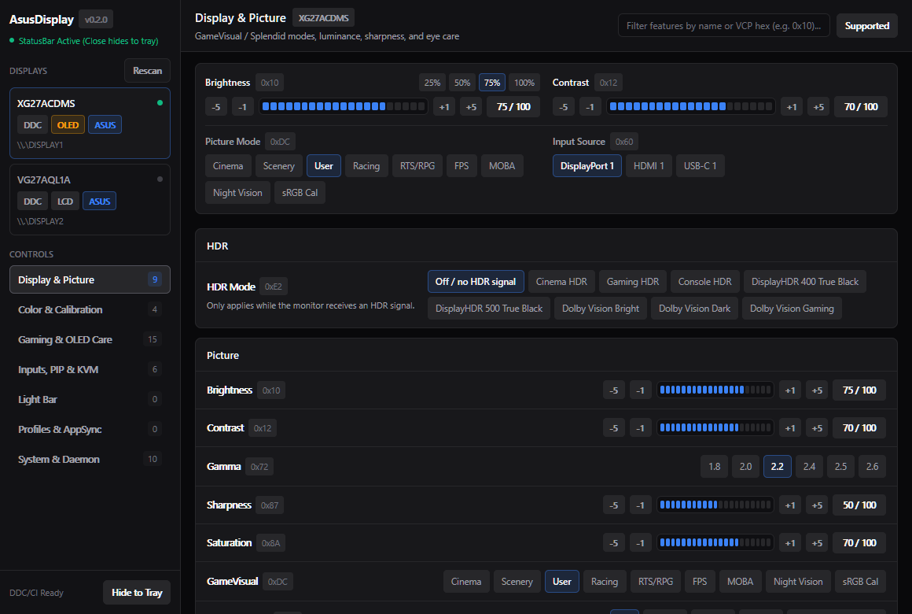

<p align="center">
  
</p>

<h1 align="center">AsusDisplay</h1>

<p align="center">
  <b>A free ASUS DisplayWidget Center alternative for Linux and Windows.</b><br>
  Control your ASUS monitor from your desktop: brightness, GameVisual modes, HDR, OLED care,
  GamePlus, colour and input.
</p>

<p align="center">
  
</p>

ASUS only makes DisplayWidget Center for Windows, and there's no ASUS monitor software for Linux at
all. AsusDisplay does the same job on both. You change your monitor's settings from a normal app
window instead of the joystick and on-screen menu.

It's free and open source, a few MB, with no account and no telemetry.

## What it can do

- **Brightness and contrast** sliders that change instantly.
- **GameVisual and Splendid picture modes:** FPS, Racing, Cinema, sRGB and the rest, one click away.
- **Gaming settings:** HDR mode, Shadow Boost, Variable Overdrive, and the GamePlus crosshair, timer
  and FPS counter.
- **OLED care** for ROG OLED monitors: pixel cleaning, screen move, uniform brightness, logo and
  taskbar detection.
- **Colour:** colour temperature, gamma, red/green/blue gain and saturation.
- **Input switching** between HDMI, DisplayPort and USB-C, plus KVM and picture-in-picture on
  monitors that have them.
- **Profiles:** save your settings and switch back with one click. Pick a picture mode per app, and
  the monitor switches when you open that game.
- **Tray icon:** close the window and change modes, inputs, brightness or profiles from the system
  tray. On Linux you can scroll on the icon to change brightness.
- **Several monitors** at once, each in its own tab.
- **ASUS monitor light bars** (Linux).

The app asks your monitor what it supports and only shows those settings, so you won't see
controls your monitor doesn't have.

## Supported monitors

There's no model list. Like DisplayWidget Center, the app reads what each monitor supports, so any
ASUS monitor that works with DisplayWidget Center should work here: ROG Strix, ROG Swift, TUF
Gaming, ProArt, ZenScreen and the rest of the ASUS range.

| Monitor | Tested |
|---|---|
| ROG Strix XG27ACDMS (QD-OLED) | yes |
| TUF Gaming VG27AQL1A (IPS) | yes |
| Other ASUS monitors | should work, please tell me |
| Other brands | basic controls only (brightness, contrast, input, colour) |

Tried it on a monitor that isn't listed? [Open an issue](../../issues) and say how it went, even if
it just works. **Copy report** in the app's Settings page copies everything I need.

<p align="center">
  
  <br><em>A different monitor gets a different set of pages.</em>
</p>

## Install

### Windows

There's no installer yet, so you build it once:

1. Install [Rust](https://rustup.rs) and Visual Studio Build Tools with **Desktop development with C++**.
2. Run:
   ```powershell
   git clone https://github.com/KharalDipendra/Asus-Displaywidget-Linux
   cd Asus-Displaywidget-Linux
   cargo build --release --workspace
   ```
3. Start `target\release\asusdisplay-gui.exe`.

You can keep DisplayWidget Center installed, just don't run both at the same time.

### Linux

On Arch:

```sh
sudo pacman -S --needed rust base-devel vulkan-icd-loader libxkbcommon libxkbcommon-x11 wayland

git clone https://github.com/KharalDipendra/Asus-Displaywidget-Linux
cd Asus-Displaywidget-Linux
cargo build --release --workspace
sudo install -Dm755 target/release/asusdisplay /usr/local/bin/asusdisplay
sudo install -Dm755 target/release/asusdisplay-gui /usr/local/bin/asusdisplay-gui
sudo install -Dm644 linux/asusdisplay.desktop /usr/share/applications/asusdisplay.desktop
sudo install -Dm644 gui/assets/icon.png /usr/share/icons/hicolor/512x512/apps/asusdisplay.png
```

On other distros, install Rust plus your distro's Vulkan, xkbcommon and Wayland packages, then run
the same steps.

Then let the app talk to your monitors (once):

```sh
sudo install -Dm644 linux/i2c-dev.conf /etc/modules-load.d/i2c-dev.conf
sudo install -Dm644 linux/60-asusdisplay-i2c.rules /etc/udev/rules.d/60-asusdisplay-i2c.rules
sudo modprobe i2c-dev
sudo udevadm control --reload && sudo udevadm trigger
```

AsusDisplay is now in your app menu.

## FAQ

### Does ASUS DisplayWidget Center work on Linux?

No, ASUS only releases it for Windows. AsusDisplay is the Linux alternative, and it runs on Windows
too.

### Is it safe for my monitor?

It sends the same standard monitor commands (DDC/CI) that DisplayWidget Center sends. Disruptive
actions like pixel cleaning or resetting your settings always ask first.

### My monitor doesn't show up

Turn on DDC/CI in the monitor's on-screen menu, and close DisplayWidget Center if it's running. On
Linux, check you did the step above. More fixes, including NVIDIA on Linux, are in
[troubleshooting](docs/ADVANCED.md#troubleshooting).

### A monitor went missing after a graphics driver crash or update

Click **Rescan** in the title bar. On Windows the app usually finds it again by itself.

### Can I control my monitor from the command line or a keyboard shortcut?

Yes, there's a command-line tool too. See [docs/ADVANCED.md](docs/ADVANCED.md).

## About this project

AsusDisplay was built with substantial help from AI:

- **Protocol.** The monitor commands were reverse engineered by decompiling ASUS DisplayWidget
  Center and tracing which command each setting sends.
- **Code.** AI helped write the library, the command-line tool and the desktop app.

All AI output is reviewed personally before being committed. The monitors I own were tested on real
hardware; support for other models relies on community testing and feedback, so bug reports and
PRs are very welcome.

No ASUS code is included in this repository. This project is not affiliated with, authorised by, or
endorsed by ASUS. "ASUS", "ROG", "TUF" and "ProArt" are trademarks of their owner.

## License

MIT, see [LICENSE](LICENSE).
